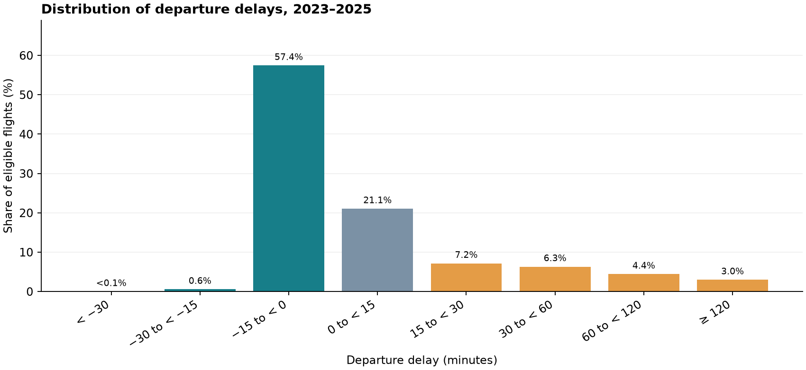
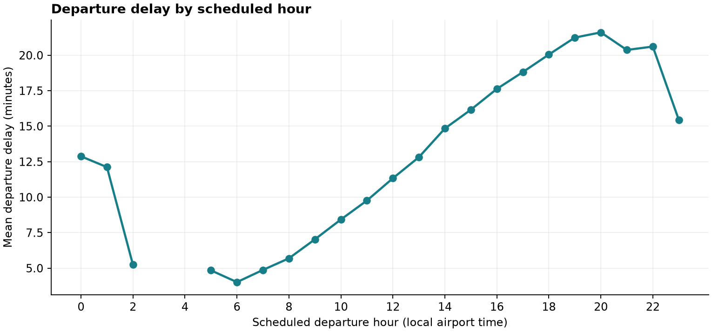
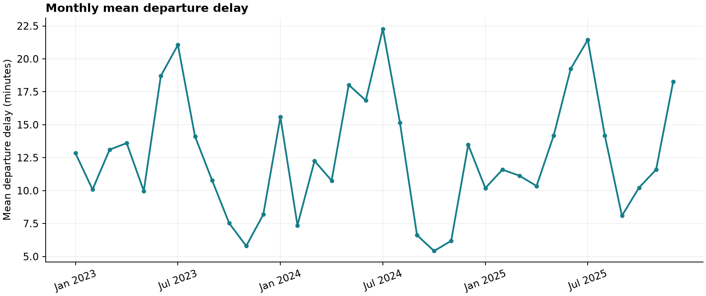

# STAT 4P87 U.S. flight delay study

The modeling dataset combines 2023–2025 BTS reporting-carrier domestic flights with airport metadata, historical observations and archived destination aviation forecasts. The signed BTS departure delay is the outcome. Weather is matched at or before a prediction cutoff 60 minutes before scheduled departure; destination forecasts must be issued by that cutoff and cover scheduled arrival. Eligible non-cancelled flights are stored as one partitioned Parquet dataset, with 2023–2024 designated for training and 2025 for testing. Flight schedules and weather delivery times have historical-availability limitations described below.

## Regenerate the dataset

From a fresh clone, install Python 3.11 or later and run from the repository root:

```bash
python3 -m venv .venv
.venv/bin/python -m pip install -e '.[test]'
.venv/bin/python src/main.py
```

This one command downloads and validates monthly BTS files, obtains airport metadata and IEM observations for the 40 highest-traffic eligible stations, constructs timestamps and weather matches, adds destination forecasts, and runs the final data audit. Work is checkpointed; if a stage fails, rerun the same command to resume. Status and logs are written under `reports/`. The run needs network access and can take substantial time. It enforces an approximate 10 GiB limit on the workspace `data/` directory and keeps 2 GiB of free disk as a reserve; temporary extraction is included in the checks. Raw data, intermediate data and Parquet files are not included in GitHub.

**Final dataset:** `data/processed/history/flights_model_ready/`. It is one Arrow-compatible dataset partitioned by year and month, not one Parquet file. Read the directory using R's `arrow::open_dataset()`; see `analysis/load_model_ready.R`. Intermediate source and master partitions remain on disk for validation and reproducibility, but they are not separate deliverables. Run `.venv/bin/pytest -q` for the automated tests.

For a smaller end-to-end check, use a separate workspace. This downloads January 2024 flights plus weather and forecasts for two airports and does not alter the full dataset:

```bash
.venv/bin/python src/main.py --smoke --workspace /tmp/flight-delay-smoke
```

Use `--workspace /path/to/workspace` without `--smoke` to place the full run elsewhere. Each workspace has its own `data/` and `reports/`. Cached downloads and completed partitions are reused; delete or archive a workspace only if you intend to rebuild it. The live data sources and airport metadata can be revised, so a fresh download may not reproduce earlier results byte for byte. BTS records are limited to reporting-carrier nonstop domestic flights, including eligible U.S. territories; they do not cover international flights or all carriers.

## Data quality and limitations

The existing full run produced 20,928,579 scheduled-flight master records and 20,420,136 eligible modeling rows. Its final audit checks row identifiers, official BTS outcome values, weather and forecast cutoff times, destination station mapping, and the temporal split. The label consistency check reconstructs actual UTC using BTS's own delay and checks the local clock; it is not independent confirmation of the precise delay. Ambiguous local times and other unresolved records are excluded from the modeling dataset but retained in the master. Previous-flight links in the intermediate master are tentative and excluded from strict predictive features because historical aircraft-assignment availability is unknown.

Observed weather is available for a subset of airports, and conservative destination forecast intervals cover only some flights. BTS final schedules are assumed available at the cutoff, and observation or forecast issue times may precede actual publication. Consequently this is suitable for exploratory modeling, not a proven real-time backtest. See `reports/data_dictionary.md` for field definitions, `reports/model_readiness.md` for methodology, `reports/model_validation.json` for the last full-run audit, and `reports/polished_model_sample.csv` for example rows. Weather stations, airport metadata and live source revisions can affect regenerated coverage.

<!-- EXPLORATORY SUMMARY START -->
## Exploratory summary

The figures use **20,420,136 eligible non-cancelled flights** in the 2023–2025 modeling dataset, not all scheduled flights. Delay is the signed BTS departure delay: negative values are early. These are unadjusted descriptions, not estimates of causal effects. Cancellations are included only in the annual scheduled-flight table below.

| Statistic | Value |
|---|---:|
| Mean departure delay | 12.8 min |
| Median departure delay | -2.0 min |
| 90th percentile | 44.0 min |
| Departed early (< 0 min) | 58.0% |
| Departed at least 15 min late | 20.9% |



The chart uses two-minute bins from −30 to under 120 minutes, with percentages calculated over all eligible flights. The unplotted tails contain 960 flights below −30 minutes (0.005%) and 609,906 flights at 120 minutes or more (2.99%). These flights remain included in the summary statistics and dataset.



Hours with fewer than 1,000 flights are omitted from the plot; the remaining overnight hours also have fewer flights than daytime hours.



| Year | Scheduled flights in master | Cancelled | Eligible flights | Mean delay (min) | Median delay (min) | ≥15 min late |
|---|---:|---:|---:|---:|---:|---:|
| 2023 | 6,847,899 | 87,943 (1.3%) | 6,690,114 | 12.2 | -2.0 | 20.5% |
| 2024 | 7,079,061 | 96,315 (1.4%) | 6,907,536 | 12.6 | -2.0 | 20.6% |
| 2025 | 7,001,619 | 102,876 (1.5%) | 6,822,486 | 13.5 | -2.0 | 21.7% |

**Five busiest origin airports in the eligible sample**

| Origin | Eligible departures | Mean delay (min) | ≥15 min late |
|---|---:|---:|---:|
| ATL | 982,089 | 12.2 | 21.3% |
| DEN | 905,356 | 15.1 | 25.2% |
| DFW | 895,723 | 18.0 | 26.6% |
| ORD | 853,354 | 15.4 | 22.6% |
| CLT | 599,982 | 16.0 | 24.1% |

The master covers BTS reporting-carrier flights, not every flight. The modeling subset excludes cancellations and records without a clock-consistent delay; exclusions may affect these summaries. Flight mix, routes, and weather differ across airports and hours. Regenerate these figures and tables with `.venv/bin/python src/create_summary.py` (requires the local Parquet data).
<!-- EXPLORATORY SUMMARY END -->
